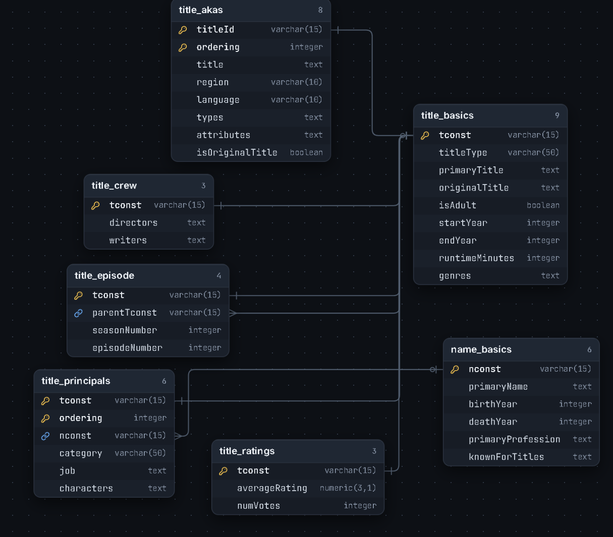

# Livrable 5 : Analyse, Schémas et Automatisation des données IMDb

**Date de rendu :** 15 novembre 2026
**Équipe :** Thomas Chandellier (manager), Tom Peyredieu, Théo Bordes-Da Silva, Lissam Loufti

1. ## Analyse de la base de données fournie

Les données brutes d'IMDb sont répartis dans 7 fichier compressés (`.tsv.gz`). Chaque fichier contient des millions de lignes necessitant une structuration rigoureuse dans un SGBDR pour garantir les performance et l'intégrité référentielle.

**Choix techniques :**

- **SGBD :** PostgreSQL 16 (Conteneur Docker `db_dev`).

- **Types de données :** Utilisation intensif du type `TEXT` pour les titres et les noms afin de prévenir les erreur de dépassement (`VARCHAR` trop courts).

- **Tableaux (Arrays) :** Les listes fournies par IMDb (comme `genres`, `directors`, `primaryProfession`) sont stocké sous forme de `TEXT` brut délimité par des virgules pour optimisé la vitesse d'importation, et serons traiter de manière applicative (PHP) ou par des vues SQL ultérieures.

## 2. Diagramme UML de la base de données

Voici la modelisation de notre base de donnée. Les relations respectes strictement les dépendances identifier dans les fichiers sources.

## 3. Scripts d'automatisation (Téléchargement et Chargement)

Afin de maintenir la base de donnée a jour de manière automatisé, nous avons développés deux scripts distincts (disponibles à la racine de notre dépôt Git) :

1. **`download_imdb.py`** : Script Python qui interroge les serveur `datasets.imdbws.com`, télécharge les 7 archives `.tsv.gz` de manière sécurisé (gestion des erreurs HTTP) et calcul la taille et le temps de téléchargement de chaque fichier.

2. **`load_imdb.sh`** : Script Bash s'executant directement sur le serveur Debian. Il decompresse les données a la volé (`zcat`) et les injectes dans le conteneur PostgreSQL via la commande native `COPY`. L'ordre d'insertion est strictement définit pour respecté les contraintes de clés étrangères (ex: `title_basics` avant `title_akas`).

_(Le script de création des tables est disponible dans le fichier `schema_imdb.sql`)_.

## 4. Indicateurs de performance

Lors de notre execution sur le serveur (Debian / PostgreSQL 16) le 15 novembre 2026, les performances relevé par nos script on été les suivantes :

### A. Phase de récupération (Téléchargement HTTP)

- `name.basics` (298.5 Mo) : 18.9 sec

- `title.akas` (499.0 Mo) : 31.9 sec

- `title.basics` (219.7 Mo) : 14.3 sec

- `title.crew` (80.2 Mo) : 5.4 sec

- `title.episode` (52.9 Mo) : 3.4 sec

- `title.principals` (754.2 Mo) : 48.3 sec

- `title.ratings` (8.3 Mo) : 0.7 sec

- **Temps total de téléchargement : 122.90 secondes.**

### B. Phase de chargement (Insertion PostgreSQL - COPY)

- Insertion dans `name_basics` : _\[pas encore fini\]_

- Insertion dans `title_basics` : _\[pas encore fini\]_

- Insertion dans `title_akas` : _\[pas encore fini\]_

- Insertion dans `title_crew` : _\[pas encore fini\]_

- Insertion dans `title_episode` : _\[pas encore fini\]_

- Insertion dans `title_principals` : _\[pas encore fini\]_

- Insertion dans `title_ratings` : _\[pas encore fini\]_

- **Temps total d'insertion en BDD : _\[pas encore fini\]_ secondes.**